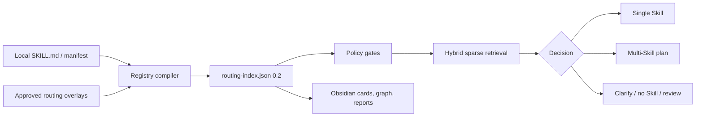

<div align="left">

# Obsidian Skill Router

**Your agent has Skills. It still needs a reliable way to choose them.**

A deterministic, offline Python router that compiles local Skill metadata into
an auditable registry, selects and orders Skills for single- or multi-step
tasks, and stops for clarification or review when needed.

Local-first · explainable · zero runtime dependencies · no runtime LLM

</div>

[](https://github.com/xiademo/obsidian-skill-router/releases/latest)
[](https://github.com/xiademo/obsidian-skill-router/actions/workflows/ci.yml)
[](https://www.python.org/)

[简体中文](README.zh-CN.md) | **English**

> This repository contains the router, not any routed Skill. It never installs,
> downloads, updates, publishes, or executes Skills.

## The problem starts before execution

A folder works when it contains ten obvious Skills. It becomes unreliable when
it contains dozens or hundreds:

- Similar names and descriptions send keyword routers to the wrong Skill.
- Missing capabilities trigger a vaguely related substitute instead of a clean
  “no Skill” decision.
- Multi-step work needs several Skills, dependency order, and one combined risk
  decision—not a flat Top-K list.
- Manual, explicit-only, and profile-only modes pass through hard policy gates
  before relevance scoring; incompatible or negatively triggered Skills are
  excluded.
- High or unknown overall risk, or high action risk, must never boost
  relevance; a matching Skill becomes `review_required` instead.
- Runtime LLM routing can change between calls and rarely leaves an auditable
  reason for the choice.

The expensive failure is not “no recommendation.” It is a confident, wrong
activation.

## The need: a decision layer, not another Skill manager

You already have local Skills. This project adds the missing layer between a
task and those Skills:

| When this happens | Router response |
| --- | --- |
| One Skill clearly fits | `recommend` with evidence and a Skill Card path |
| Two candidates are both plausible | `clarify_required` with one deterministic question |
| No local capability fits | `continue_without_skill` instead of a near-miss |
| Risk or policy blocks auto-use | `review_required` with the exclusion reason |
| The task contains several stages | `skill_plan` with dependency-aware ordering |

Use it when you maintain a growing local Skill library, integrate an agent
Hook, or need reviewable routing policy. If you want a Skill marketplace,
installer, executor, or Obsidian UI, this is not that product.

The Registry is the machine truth. Obsidian is the readable, auditable view.
The Hook is only a transport adapter. Python owns every routing decision.

## Try it in 60 seconds

Requirements: Python 3.10+, an already-downloaded local Skill directory, and a
separate local directory for the generated Vault. Obsidian is optional.

Install the pinned release:

```bash
pipx install "git+https://github.com/xiademo/obsidian-skill-router.git@v0.2.0"
obsidian-skill-router --version
```

`uv` works too:

```bash
uv tool install "git+https://github.com/xiademo/obsidian-skill-router.git@v0.2.0"
```

Compile, validate, then route:

```bash
obsidian-skill-router scan --skills-root "/path/to/.codex/skills" --vault "/path/to/SkillRouterVault"
obsidian-skill-router validate --vault "/path/to/SkillRouterVault" --strict --check-sources
obsidian-skill-router --json route --vault "/path/to/SkillRouterVault" --strategy hybrid --task "extract text from this PDF"
```

Version `0.2.0` keeps `legacy` as the migration default. Use the explicit
`--strategy hybrid` shown above for the new router. `hybrid-graph` remains an
experimental shadow strategy.

Abridged real response shape:

```json
{
  "command": "route",
  "data": {
    "decision": {
      "type": "review_required",
      "reason_code": "policy_review"
    },
    "primary": {
      "name": "PDF Extract",
      "package": "document-processing"
    },
    "policy": {
      "requires_review": true,
      "risk_level": "unknown"
    }
  },
  "ok": true
}
```

Unknown risk does not silently become low risk. The router finds the relevant
Skill, then asks for review instead of pretending auto-use is safe.

See [Installation](docs/INSTALLATION.md) for Windows PowerShell, virtual
environments, upgrades, and uninstall instructions.

## How the decision is built



1. **Compile once.** Normalize `SKILL.md`, manifests, explicit routing rules,
   and approved offline enrichment into schema `0.2`.
2. **Gate before ranking, review after matching.** Enforce route mode, profile,
   compatibility, and negative triggers before ranking. Permissions, side
   effects, and action risk never boost relevance and can elevate a match to
   `review_required`.
3. **Retrieve globally.** Fuse exact name/alias matches, field-weighted BM25F,
   Chinese and mixed-language character n-grams, and Package soft priors.
4. **Plan when needed.** Split explicit task stages, cover them with the smallest
   useful Skill set, expand confirmed dependencies, and topologically order it.
5. **Explain every result.** Return reason codes, evidence, excluded candidates,
   policy state, and plan steps in one JSON envelope.

Graph proximity can add at most 8% lift and remains bounded to confirmed local
relations. Candidate edges never influence default routing.

## Why Python core, not a Hook router

A Hook inherits host-specific timeout, lifecycle, stdout, and context rules. If
it also owns ranking, every host can make a different decision.

This project keeps one authoritative Python path for `scan`, `validate`,
`route`, `eval`, and tests. The optional `hook` command reads one JSON event,
returns one route envelope, and never scans or executes Skill bodies.

See the full [architecture decision](docs/ARCHITECTURE.md).

## Generated Vault

```text
00_Router/       canonical registry and router notes
01_Packages/     Package indexes and Skill cards
02_Workflows/    confirmed workflow views
03_Graph/        compatible and auditable edge exports
04_Inbox/        unclassified Skills and review candidates
05_Reports/      scan, risk, quality, graph, and calibration reports
```

`00_Router/routing-index.json` is the only machine source of truth. Markdown,
CSV, and wikilinks are derived views. The original Skill bodies are not copied
into the Vault.

## Safety boundaries

The router may read metadata and write generated artifacts. It does not:

- scan or activate `.agents/skills`;
- modify source Skills;
- install, download, update, publish, or execute Skills;
- call an external API or runtime LLM;
- add MCP, a service, an Obsidian plugin, a vector database, or cloud sync.

> [!WARNING]
> A generated Vault is a sensitive metadata inventory. It contains local source
> paths, Skill names and descriptions, timestamps, and hashes. Keep it in a
> dedicated local directory. Review and redact it before sharing or cloud sync.

Generation happens in staging and publishes only after validation. Managed-file
hashes prevent silent overwrite of user edits; failed generation preserves the
last valid Vault.

## CLI surface

| Command | Purpose |
| --- | --- |
| `scan` | Discover Skill metadata and compile Registry plus Vault views |
| `validate` | Check schema, sources, paths, links, edges, and managed hashes |
| `route` | Return one of the five decision types; never invoke a Skill |
| `hook` | Convert one host JSON event into the same route decision |
| `report` | Read generated audit reports |
| `eval` | Compare routing strategies against repeatable fixtures and gates |

Use global `--json` before the command for one stable JSON envelope on stdout.

<details>
<summary>Common commands</summary>

```powershell
obsidian-skill-router scan --skills-root C:\path\to\skills --vault C:\path\to\vault --dry-run
obsidian-skill-router scan --skills-root C:\path\to\skills --vault C:\path\to\vault --routing-rules .\routing-rules.json --enrichment .\enrichment-proposals.json
obsidian-skill-router validate --vault C:\path\to\vault --strict --check-sources
obsidian-skill-router report --vault C:\path\to\vault
obsidian-skill-router route --vault C:\path\to\vault --task "audit Skill routing" --strategy hybrid
obsidian-skill-router eval --skills-root C:\path\to\skills --cases .\tests\fixtures\eval_cases.json --strategy legacy --strategy hybrid
Get-Content .\hook-event.json | obsidian-skill-router --json hook --vault C:\path\to\vault --strategy hybrid
```

</details>

## Quality gates

Claims are release gates, not adjectives:

- explicit Skill-name recall: 100%;
- Candidate Recall@3: at least 90%;
- Selective Precision@1: at least 85%;
- false activation: at most 1%;
- high-risk review recall and constraint respect: 100%;
- 2,000 synthetic Skills, hot-route p95: at most 100 ms;
- JSON mode stdout: exactly one valid envelope.

CI tests Python 3.10–3.13 on Ubuntu and the supported endpoint versions on
Windows. See the [test and release plan](docs/TEST_PLAN.md) for fixtures,
metrics, graph ablation, and release gates.

## Development and governance

```powershell
$env:PYTHONPATH = "src"
python -m unittest discover -s tests
```

- [Architecture](docs/ARCHITECTURE.md)
- [Installation](docs/INSTALLATION.md)
- [Contributing](CONTRIBUTING.md)
- [Security policy](SECURITY.md)
- [Changelog](CHANGELOG.md)
- [Release procedure](docs/RELEASING.md)

Released under the [MIT License](LICENSE).
