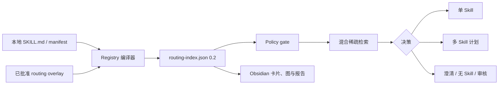

<div align="left">

# Obsidian Skill Router

**你的 Agent 已经有很多 Skill，但它仍缺少可靠的选择方法。**

一个离线、确定性的 Python Skill 路由器：把已有本地 Skill 元数据编译成
可审计 Registry，为单步和多步骤任务选对 Skill、排好依赖顺序，并在歧义
或高风险时停下来。

本地优先 · 可解释 · 零运行时依赖 · 无运行时 LLM

</div>

[](https://github.com/xiademo/obsidian-skill-router/releases/latest)
[](https://github.com/xiademo/obsidian-skill-router/actions/workflows/ci.yml)
[](https://www.python.org/)

**简体中文** | [English](README.md)

> 本仓库只包含路由器，不包含任何被路由的 Skill 本体；不会安装、下载、
> 更新、发布或执行 Skill。

## 问题发生在执行之前

十个名称清晰的 Skill 可以靠人记住。几十个、几百个之后，路由开始失真：

- 名称相近、描述重叠、中英混合，让关键词路由器选错 Skill。
- 本地没有对应能力时，系统常用“看起来差不多”的 Skill 硬凑，而不是明确拒绝。
- 多步骤任务需要 Skill 集合、依赖顺序和整体风险判断，不是平铺一份 Top-K。
- manual、explicit-only、profile-only 会在相关性排序前进入硬门控；不满足
  触发条件、不兼容或命中否定条件的 Skill 被排除。
- 整体风险为 high/unknown，或 action risk 为 high 时，不增加相关性；匹配后
  统一升级为 `review_required`。
- 运行时 LLM 每次都可能给出不同答案，也很难留下可复核的选择依据。

真正昂贵的失败不是“没有推荐”，而是一次自信但错误的自动调用。

## 产品要满足的需求：决策层，而不是另一个 Skill 管理器

你已经拥有本地 Skill。本项目补上任务与 Skill 之间缺失的决策层：

| 遇到的情况 | Router 应当返回 |
| --- | --- |
| 一个 Skill 明确匹配 | `recommend`，同时给出证据与 Skill Card 路径 |
| 两个候选都合理 | `clarify_required`，确定性生成一个澄清问题 |
| 本地没有所需能力 | `continue_without_skill`，不拿近似 Skill 充数 |
| 风险或策略禁止自动使用 | `review_required`，说明阻断原因 |
| 任务包含多个阶段 | `skill_plan`，按已确认依赖排序 |

适合正在维护不断增长的本地 Skill 库、接入 Agent Hook，或需要可审核路由
策略的人。如果你要找 Skill 商店、安装器、执行器或 Obsidian UI，这不是对应
产品。

Registry 是机器真源；Obsidian 是可读、可审计的视图；Hook 只负责协议适配；
所有路由决策都由同一个 Python 核心完成。

## 60 秒完成第一次路由

需要：Python 3.10+、已经下载到本地的 Skill 目录，以及一个与 Skill 源目录
分离的 Vault 目录。Obsidian 不是运行依赖。

安装固定版本：

```bash
pipx install "git+https://github.com/xiademo/obsidian-skill-router.git@v0.2.0"
obsidian-skill-router --version
```

也可使用 `uv`：

```bash
uv tool install "git+https://github.com/xiademo/obsidian-skill-router.git@v0.2.0"
```

编译、校验、路由：

```bash
obsidian-skill-router scan --skills-root "/path/to/.codex/skills" --vault "/path/to/SkillRouterVault"
obsidian-skill-router validate --vault "/path/to/SkillRouterVault" --strict --check-sources
obsidian-skill-router --json route --vault "/path/to/SkillRouterVault" --strategy hybrid --task "把这份 PDF 提取成文本"
```

`0.2.0` 为迁移保留 `legacy` 默认策略。使用新版 Router 时，请像上面一样
显式指定 `--strategy hybrid`；`hybrid-graph` 仍是实验性 shadow 策略。

真实输出结构的精简版：

```json
{
  "command": "route",
  "data": {
    "decision": {
      "type": "review_required",
      "reason_code": "policy_review"
    },
    "primary": {
      "name": "PDF Extract",
      "package": "document-processing"
    },
    "policy": {
      "requires_review": true,
      "risk_level": "unknown"
    }
  },
  "ok": true
}
```

未知风险不会被悄悄降为低风险。Router 先找到相关 Skill，再要求审核，不会
假装自动调用是安全的。

Windows PowerShell、虚拟环境、升级与卸载方式见
[安装文档](docs/INSTALLATION.md)。

## 一次决策如何产生



1. **一次编译，多次路由。** 把 `SKILL.md`、manifest、显式规则和已批准的
   离线 enrichment 规范化为 schema `0.2`。
2. **排序前门控，匹配后审查。** route mode、profile、compatibility 与否定
   触发在排序前执行；权限、副作用与 action risk 不增加相关性，只能把匹配
   结果升级为 `review_required`。
3. **全局检索。** 融合精确名称/alias、字段化 BM25F、中英文字符 n-gram、
   Package 软先验与 RRF。
4. **需要时编排。** 拆分明确阶段，用最小 Skill 集覆盖任务，扩展已确认依赖，
   再进行拓扑排序。
5. **每个结果可解释。** 返回 reason code、证据、排除候选、policy 状态与计划
   步骤，stdout 只输出一个 JSON envelope。

图关系只能提供最多 8% 的有界增益，并且只使用已确认的本地关系；candidate
edge 不会影响默认路由。

## 为什么是 Python 核心，而不是 Hook 路由器

Hook 会继承不同宿主的超时、生命周期、stdout 和上下文规则。如果 Hook 同时
负责排序，不同宿主可能对同一任务给出不同决定。

本项目让 `scan`、`validate`、`route`、`eval` 与测试共用一条权威 Python
路径。可选的 `hook` 命令只读取一个 JSON 事件并返回 route envelope，绝不
扫描或执行 Skill 本体。

完整决策见[架构文档](docs/ARCHITECTURE.md)。

## 生成的 Vault

```text
00_Router/       canonical Registry 与路由说明
01_Packages/     Package 索引与 Skill Card
02_Workflows/    已确认工作流视图
03_Graph/        兼容边与审计边导出
04_Inbox/        未分类 Skill 与待审核候选
05_Reports/      扫描、风险、质量、图与校准报告
```

`00_Router/routing-index.json` 是唯一机器真源。Markdown、CSV 与 wikilink
都是派生视图；原始 Skill 本体不会复制到 Vault。

## 安全边界

Router 可以读取元数据并写入生成物，但不会：

- 扫描或激活 `.agents/skills`；
- 修改源 Skill；
- 安装、下载、更新、发布或执行 Skill；
- 调用外部 API 或运行时 LLM；
- 增加 MCP、服务、Obsidian 插件、向量数据库或云同步。

> [!WARNING]
> 生成的 Vault 是敏感元数据清单，其中包含本地源路径、Skill 名称与描述、
> 时间和 hash。请使用专用本地目录；公开、分享或云同步前必须审核并脱敏。

生成过程先写 staging，校验通过后才发布。managed-file hash 可防止静默覆盖
用户修改；生成失败会保留上一版有效 Vault。

## CLI 命令

| 命令 | 用途 |
| --- | --- |
| `scan` | 发现 Skill 元数据，编译 Registry 与 Vault 视图 |
| `validate` | 校验 schema、源、路径、链接、边与 managed hash |
| `route` | 返回五态决策之一，绝不调用 Skill |
| `hook` | 把一个宿主 JSON 事件转换为同一份路由决策 |
| `report` | 读取生成的审计报告 |
| `eval` | 用可重复 fixture 与门禁比较路由策略 |

机器输出使用全局 `--json`，并把它放在子命令之前。stdout 始终只有一个稳定
JSON envelope。

<details>
<summary>常用命令</summary>

```powershell
obsidian-skill-router scan --skills-root C:\path\to\skills --vault C:\path\to\vault --dry-run
obsidian-skill-router scan --skills-root C:\path\to\skills --vault C:\path\to\vault --routing-rules .\routing-rules.json --enrichment .\enrichment-proposals.json
obsidian-skill-router validate --vault C:\path\to\vault --strict --check-sources
obsidian-skill-router report --vault C:\path\to\vault
obsidian-skill-router route --vault C:\path\to\vault --task "审核 Skill 路由" --strategy hybrid
obsidian-skill-router eval --skills-root C:\path\to\skills --cases .\tests\fixtures\eval_cases.json --strategy legacy --strategy hybrid
Get-Content .\hook-event.json | obsidian-skill-router --json hook --vault C:\path\to\vault --strategy hybrid
```

</details>

## 质量门禁

项目使用可验证门槛，不使用空泛形容词：

- 显式 Skill 名召回：100%；
- Candidate Recall@3：至少 90%；
- Selective Precision@1：至少 85%；
- False activation：不超过 1%；
- High-risk review recall 与 Constraint respect：100%；
- 2,000 个合成 Skill 热路由 p95：不超过 100 ms；
- JSON 模式 stdout：恰好一个合法 envelope。

CI 在 Ubuntu 上覆盖 Python 3.10–3.13，并在 Windows 上覆盖受支持端点版本。
fixture、指标、图消融与发布门禁见[测试与发布计划](docs/TEST_PLAN.md)。

## 开发

```powershell
$env:PYTHONPATH = "src"
python -m unittest discover -s tests
```

## 文档导航

| 需求 | 从这里开始 |
| --- | --- |
| 安装、升级或卸载 | [安装](docs/INSTALLATION.md) |
| 查找命令或参数 | [CLI 参考](docs/CLI.md) |
| 配置发现、overlay 或 enrichment | [配置与治理](docs/CONFIGURATION.md) |
| 理解路由与编排 | [架构](docs/ARCHITECTURE.md) |
| 复现质量门禁 | [测试计划](docs/TEST_PLAN.md) |
| 使用提交的 JSON 契约 | [示例](examples/README.md) |
| 贡献或发布 | [贡献指南](CONTRIBUTING.md) · [发布流程](docs/RELEASING.md) |
| 报告安全问题 | [安全策略](SECURITY.md) |

完整入口：[文档主页](docs/README.md)。版本历史：[CHANGELOG](CHANGELOG.md)。

## 仓库结构

| 路径 | 职责 |
| --- | --- |
| `src/obsidian_skill_router/` | Python 产品本体与库 |
| `docs/` | 用户、架构、评测与发布文档 |
| `examples/` | 纯合成 JSON 输入契约 |
| `tests/` | 单测、策略、安全、编排与评测回归 |
| `SKILL.md`、`agents/`、`references/` | 本仓库的 companion Skill 与 agent integration，不是产品测试所索引的实体 Skill 集合 |
| `test_artifacts/` | Git 忽略的本地扫描、构建与脱敏 workload 证据 |

项目使用 [MIT License](LICENSE)。
